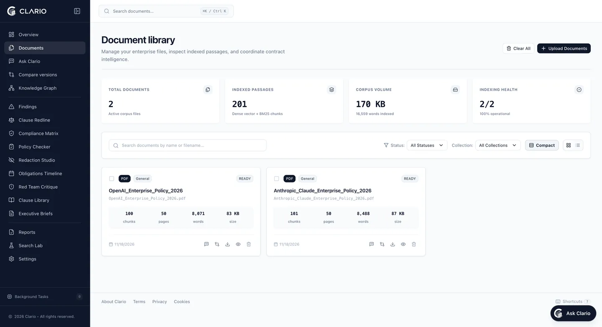
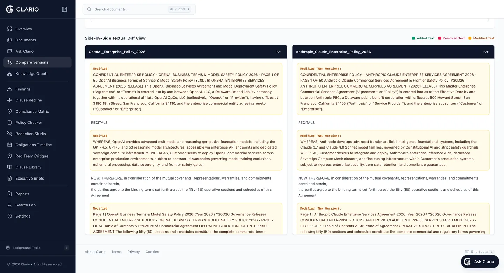
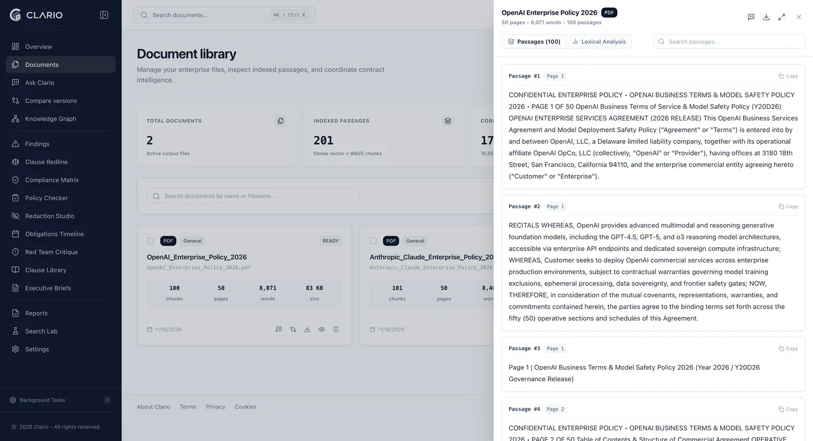

<div align="center">

  

  <p>Local-first document analysis workspace for contracts, policies, and agreements.</p>

[](https://www.python.org/)
[](https://fastapi.tiangolo.com/)
[](https://react.dev/)
[](https://www.typescriptlang.org/)
[](https://tailwindcss.com/)
[](LICENSE)

</div>

---

## Workspace Previews

<div align="center">
  
  <p><em>Overview Dashboard — Portfolio metrics, recent documents, and 6-pillar risk topology</em></p>
</div>

<br />

<div align="center">
  
  <p><em>Side-by-Side Version Comparison — Real-time diffs with added, removed, and modified passage tracking</em></p>
</div>

<br />

<div align="center">
  
  <p><em>Document Library & Source Drawer — Instant passage inspection, word analysis, and source verification</em></p>
</div>

---

## Core Modules

| Module | Purpose | Key Features |
| :--- | :--- | :--- |
| **Document Library** | File ingestion & passage index | Drag-and-drop PDF/DOCX/TXT/Excel parsing, passage extraction, source drawer inspection. |
| **Ask Clario** | Grounded question answering | Direct answers with bracketed verbatim citations (`[1]`, `[2]`) linked to source passages. |
| **Compare Versions** | Multi-version diffing | Automated similarity scoring, added/removed/modified text highlighting, and risk comparison. |
| **Clause Redline** | Negotiation & playbooks | 4 commercial stances (*Balanced*, *Customer Protective*, *Vendor Favorable*, *Strict Compliance*). |
| **Obligations Timeline** | Expiration & notice radar | Active covenants, renewal windows, notice deadlines, and one-click `.ics` calendar sync. |
| **Compliance Matrix** | Regulatory audits | EU AI Act, GDPR, HIPAA, and SOC 2 covenant alignment with automated findings promotion. |
| **Knowledge Graph** | Semantic topic discovery | Entity relationship mapping, contradiction detection, and interconnected corpus nodes. |

---

## Tech Stack

### Backend (Python & FastAPI)
- **Runtime:** Python 3.12+
- **Framework:** FastAPI with Uvicorn
- **Database & ORM:** SQLite with SQLAlchemy ORM (automatic creation and migration)
- **Parsers:** PyPDF / PyMuPDF (`fitz`), `python-docx`, `openpyxl`
- **Retrieval:** Hybrid search with Okapi BM25, Sentence Transformers embeddings, and Reciprocal Rank Fusion (RRF)
- **Local AI:** Seamless integration with Ollama, LM Studio, vLLM, and zero-latency extractive fallback

### Frontend (React & TypeScript)
- **Framework:** React 18 with TypeScript
- **Build Tool:** Vite 5
- **Styling:** Tailwind CSS with Clario design system (Navy `#0F172A`, Slate `#334155`, Ivory `#F8FAFC`, Border `#E2E8F0`)
- **Icons:** Lucide React (monochrome slate/navy theme)
- **State Management:** TanStack Query v5 + React Router v6
- **Testing:** Vitest + React Testing Library

---

## Quick Start

### Automated Setup
Clone the repository and run the setup script for your platform:

```bash
git clone https://github.com/karthik558/Clario.git
cd Clario
```

- **macOS:**
  ```bash
  bash initialize/init_mac.sh
  ```
- **Linux (Ubuntu / Debian / Fedora / Arch):**
  ```bash
  bash initialize/init_linux.sh
  ```
- **Windows:**
  ```cmd
  initialize.bat
  ```
  *(or double-click `initialize.bat` / `initialize\init_windows.bat` directly in Windows Explorer)*

---

### Launching the Application

Start both the backend API and frontend workspace with a single command:

- **macOS / Linux:**
  ```bash
  ./start.sh
  ```
- **Windows:**
  ```cmd
  start.bat
  ```

Once running, access the workspace:
- **Frontend Workspace:** [http://localhost:5173](http://localhost:5173)
- **Backend API:** [http://localhost:8000](http://localhost:8000)
- **API Documentation (Swagger):** [http://localhost:8000/docs](http://localhost:8000/docs)

---

## Manual Setup & Testing

### Backend
```bash
cd backend
python3 -m venv venv
source venv/bin/activate       # Windows: venv\Scripts\activate.bat
pip install -r requirements.txt
PYTHONPATH=. uvicorn app.main:app --port 8000 --reload
```

Run backend test suite:
```bash
PYTHONPATH=backend backend/venv/bin/pytest backend/tests
```

### Frontend
```bash
cd frontend
npm install
npm run dev
```

Run frontend test suite:
```bash
npm test -- --run
```

Build production bundle:
```bash
npm run build
```

---

## Local AI Integration (Optional)

Clario defaults to **Extractive Synthesis** (zero-latency, source-exact answers with zero network calls).  
If you want generative synthesis using a local LLM:

1. Install and start [Ollama](https://ollama.ai/):
   ```bash
   ollama pull gemma3:latest
   ```
2. In Clario, navigate to **Settings** (`/settings`) or toggle **Answer Settings** in **Ask Clario** to select your active local model.

---

## License

Licensed under the MIT License. See [LICENSE](LICENSE) for details.
